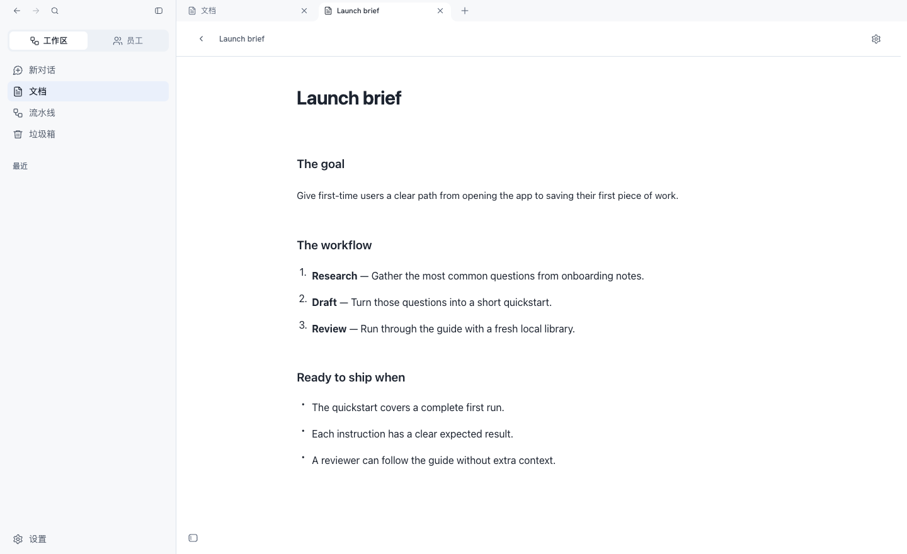

<h1 align="center">
  <picture>
    <source media="(prefers-color-scheme: dark)" srcset="web/ui/brand/wordmark-reverse.svg">
    
  </picture>
</h1>

<h3 align="center">Turn your AI agents into a working team.</h3>

<p align="center">
  Give Codex CLI and Claude Code defined roles, connect their work in pipelines,<br>
  and keep conversations and documents in a workspace on your computer.
</p>

<p align="center">
  <a href="#run-locally"><strong>Run locally</strong></a> ·
  <a href="sdk/README.md">Explore the SDK</a> ·
  <a href="https://runteams.ai/">RunTeams website</a>
</p>

<p align="center">
  <a href="https://github.com/paliacci/runteams/actions/workflows/core.yml"></a>
</p>



*A sample launch brief open in the RunTeams Local workspace.*

## Give repeatable work a home

Imagine preparing a release brief every week. A researcher collects the changes, a writer turns them into a draft, and a reviewer checks the result. In RunTeams, those roles and handoffs can live in a pipeline you use again next week.

- **Give an agent a role.** Define its responsibilities, instructions, and skills. RunTeams calls a reusable role an *employee*.
- **Connect roles in a pipeline.** Pass work between steps and review results before they move on.
- **Keep the work together.** Return to the conversations, documents, and work records behind a result in your local library.

This repository contains **RunTeams Local**, the free, account-free edition, along with the shared UI and SDK. RunTeams saves your workspace on your computer. Your configured CLI and model provider handle model requests.

## Run locally

Use Python 3.12 and a browser.

```sh
git clone https://github.com/paliacci/runteams.git
cd runteams
python3.12 -m venv .venv
.venv/bin/python -m pip install .
.venv/bin/runteams-community --port 8792 --open
```

RunTeams opens at `http://127.0.0.1:8792`. Open the model channels section in Settings and connect your installed Codex CLI or Claude Code. Start with one employee and a task you expect to do again.

RunTeams stores your library separately from the installation. Use `--data-dir /absolute/path/to/library` to choose a different library. Reinstall the package after editing the source. To build the standalone macOS app for Apple silicon, see the [desktop build guide](docs/releasing.md).

## Build with RunTeams

Use the SDK to add tools and interactive work views with MCP Apps, or package an employee or pipeline as a reusable project. The [SDK guide](sdk/README.md) explains the runtime and UI libraries. The [authoring guide](runteams_creator_dev/MCP_AUTHORING.md) covers checking, building, previewing, and packaging a project locally.

- [Architecture](docs/architecture.md) and [core module map](docs/core-domains.md) for navigating the source.
- [Development guide](docs/development.md) and [tool inventory](tooling/commands.json) for running checks and preparing the SDK.
- [Contributing](CONTRIBUTING.md), [security reporting](SECURITY.md), and [changelog](CHANGELOG.md) for working with the project.

## License

The local product source uses the [RunTeams Source Available License 1.0](LICENSE). You can use and modify it for internal work, including paid client work, and sell independently authored employees, pipelines, skills, or integrations. Commercial redistribution of RunTeams and offering it as a commercial hosted product require separate written permission.

The `sdk/runtime`, `sdk/view`, and `sdk/ui` libraries use Apache-2.0. Third-party components retain their own licenses. See the [licensing guide](docs/legal/LICENSING.md) and [third-party notices](docs/legal/THIRD_PARTY_DOCUMENTS.md).
